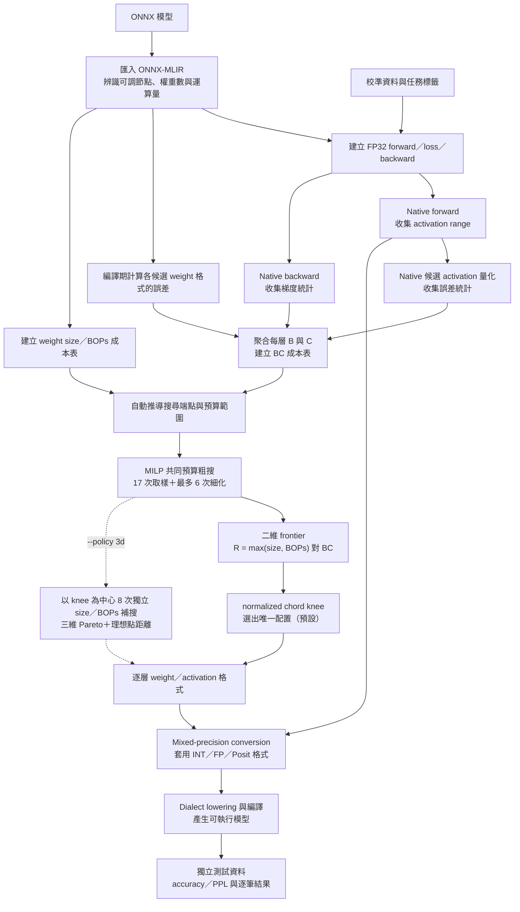

# Native Mixed-Precision 自動搜尋 Pipeline

更新日期：2026-10-11（Asia/Taipei）

本文件描述從 ONNX 模型、校準資料，到逐層格式選擇、ONNX-MLIR 編譯與最終評估的完整流程。主要 criterion 為 BC，候選格式包含 INT、FP 與 Posit；SQNR 是比較用 baseline。

正式 auto 入口（`run_native_auto.py`）的預設流程為：

**Native BC 成本表 → MILP 共同預算粗搜 → 二維 frontier 的 normalized chord knee 選點 → 編譯與評估。**

另一個選項 `--policy 3d` 在粗搜之後加上獨立資源局部補搜、三維 Pareto 與三軸理想點距離選點（§7.4、§8）。2026-10-11 起預設改回二維 knee，原因見 §12.1：三維政策在 Qwen3-0.6B 上選到全 int4 權重，PPL 由 49.9 升到 108。

## 1. 目標與目前實作狀態

此 pipeline 的目標是自動選擇各層的 weight／activation 格式，讓使用者不必先指定模型大小或 BOPs 預算，也不必提供 reference accuracy 來選配置。

| 部分 | 目前狀態 |
|---|---|
| Native range、梯度與量化誤差統計 | 已實作，由 ONNX-MLIR 產生並執行統計圖 |
| BC 成本表 | 已實作，以 native 統計聚合 B、C |
| Posit 候選格式及 dialect lowering | 已實作並納入實驗 |
| `run_native_auto.py`（正式 auto 入口） | 預設：共同資源 `max`＋二維 frontier knee（`mp_auto.auto_select`）；另含 FP32 基準、分程序評估 |
| MILP 粗搜＋局部補搜＋三維 Pareto | 已在 `benchmark_native_search.py` 完成五模型驗證；整理為 `mp_auto.auto_select_3d`，在五模型上與 benchmark 選點完全相同 |
| 三維方案進入正式入口 | 已整合為 `--policy 3d`，不是預設（§12.1） |
| 搜尋與流程協調 | 仍由 Python／SciPy MILP 執行 |

「Native」指統計圖、backward 圖與推論模型透過 ONNX-MLIR 編譯執行。目前尚未將整個搜尋器做成 compiler 內部 pass。

## 2. 整體流程圖



實線為預設流程；虛線為 `--policy 3d` 選項（§8）。測試資料只在配置固定後進入最後一階段，沒有回饋至搜尋或選點的路徑。

## 3. 輸入、候選與搜尋範圍

### 3.1 必要輸入

| 輸入 | 用途 |
|---|---|
| ONNX 模型 | 原始圖結構與權重 |
| 校準資料 | 取得 activation range、量化誤差與梯度統計 |
| 校準標籤或任務 target | 定義任務 loss |
| 候選格式集合 | 決定各層可選的 weight／activation 格式 |
| 模型／任務 adapter | 定義可調節點、輸入處理、loss 與最終評估方式 |
| 獨立測試資料 | 配置固定後評估品質，不參與搜尋 |

目前 adapter 包含 MobileNetV2、ResNet18、EfficientNet-B0、GPT-2、BERT、Qwen3-0.6B（`qwen3_prepare.py`：與 GPT-2 相同的 WikiText-2 128-token windows，196 個 transformer projection；embedding、綁定的 LM head 與 norm 維持 FP32）。分類模型使用分類 loss；GPT-2、Qwen3 使用 next-token loss（加總），沒有 next-token target 的最後位置不納入 loss。

現有實驗每模型使用 10 筆校準輸入。這是實驗設定，不是演算法必須固定為 10 筆。

### 3.2 候選格式

```text
int4, int5, int6, int7, int8,
p4e1, p6e1, p8e1,
f16, bf16, fp32
```

Weight 與 activation 各有 11 種候選，因此每個可調節點最多有 121 種組合。Posit 以自己的量化誤差與位元成本參與同一套搜尋，沒有額外優先權。

目前選擇單位是 adapter 指定的帶權重節點；未納入搜尋的運算維持 FP32。GPT-2 等模型只調整指定 projection 節點，並非所有運算都納入資源估算與格式選擇。

## 4. Native 校準與誤差統計

這個階段將模型轉成一張可重複查詢的成本表，避免為每個完整混合精度配置重新執行校準。

### 4.1 Activation range

以校準資料執行原始 FP32 forward，收集量化位置的 min／max。INT activation 量化使用這些範圍計算各位元數的 scale／zero-point。

Range 會同時供 activation 誤差統計及最終 mixed-precision conversion 使用，維持搜尋模型與編譯模型的量化設定一致。

### 4.2 Weight 量化誤差

Weight 是模型常數，可在編譯期計算各候選格式的量化誤差。INT weight 使用 per-output-channel 量化；實際 channel 軸依運算與權重 layout 決定。

令第 (l) 層、第 (o) 個輸出 channel 的權重索引集合為 (I_{l,o})，則：

$$
D^W_{l,o}(w)
=\sum_{i\in I_{l,o}}\left(Q_w(W_{l,i})-W_{l,i}\right)^2
$$

Posit 的可表示值／量化相關邏輯已有共用 LUT 實作，供對應的統計與轉換程式使用。

### 4.3 FP32 loss 與 backward

從原始 FP32 forward 和任務 loss 建立 backward，透過 native 執行取得：

$$
g^W=\frac{\partial L}{\partial W},
\qquad
g^t=\frac{\partial L}{\partial t}
$$

量化格式提供「擾動有多大」，原始模型的梯度提供「這個位置對 loss 有多敏感」。這套 BC 流程使用 FP32 backward 的梯度，不需要對 Posit round 求導，也不需要為此引入 STE。

梯度統計可由所有候選格式共用，不需要為每種格式重新 backward。

### 4.4 Activation 量化誤差

對校準 forward 中的量化位置 (t)，計算候選 activation 格式 (a) 的誤差：

$$
\delta_{s,t,c,p}(a)=Q_a(t_{s,c,p})-t_{s,c,p}
$$

其中 (s) 表示校準輸入，(c) 表示 channel，(p) 表示該 channel 內的位置。

保留各 channel 的誤差和與平方和：

$$
S_{1,t,c}(a)=\sum_{s,p}\delta_{s,t,c,p}(a),
\qquad
S_{2,t,c}(a)=\sum_{s,p}\delta_{s,t,c,p}(a)^2
$$

目前固定 shape 的校準流程使用 (n_t=N_{\mathrm{cal}}P_t)，得到：

$$
\mu_{t,c}(a)=\frac{S_{1,t,c}(a)}{n_t},
\qquad
\sigma^2_{t,c}(a)=\frac{S_{2,t,c}(a)}{n_t}-\mu_{t,c}(a)^2
$$

### 4.5 執行依賴

Weight 誤差、梯度統計，以及 range→activation 誤差三條工作鏈可安排並行；activation 誤差鏈必須先取得 range。這是校準階段的排程，與後續 MILP 搜尋彼此獨立。

## 5. BC criterion 的組成

### 5.1 Weight term：B

令 (m_{l,o}=|I_{l,o}|)，目前的權重梯度統計聚合為：

$$
G^W_{l,o}
=\frac{1}{m_{l,o}}\sum_s\sum_{i\in I_{l,o}}(g^W_{s,l,i})^2
$$

因此：

$$
B_l(w)=\sum_o G^W_{l,o}\,D^W_{l,o}(w)
$$

此處除以的是每個 channel 的權重元素數；校準輸入的梯度平方沿樣本加總，並未另外除以校準樣本數。

### 5.2 Activation term：C

定義：

$$
G_{2,t,c}=\sum_{s,p}(g^t_{s,c,p})^2
$$

$$
G_{c,t,c}=\sum_s\left(\sum_p g^t_{s,c,p}\right)^2
$$

第二式是「每筆輸入先對位置加總、平方，再跨輸入加總」，不可替換成所有輸入與位置先一起加總再平方。

對第 (l) 層目前使用的 input／output 量化位置 (T_l=\{x_l,y_l\})：

$$
C_l(a)=\sum_{t\in T_l}\sum_c
\left[
G_{2,t,c}\,\sigma^2_{t,c}(a)
+G_{c,t,c}\,\mu_{t,c}(a)^2
\right]
$$

前一項反映誤差變異，後一項反映誤差平均偏差的影響。

### 5.3 每層與整個配置的 BC

$$
E_l(w,a)=B_l(w)+C_l(a)
$$

$$
E(q)=\sum_l E_l(w_l,a_l)
$$

這是可加總的代理目標，方便 MILP 求解；它沒有精確描述所有跨層誤差交互作用，也不是實際 accuracy 或 loss 變化的保證。

## 6. 資源成本模型

令 (N_l) 為權重元素數、(F_l) 為該層運算量 proxy，則：

$$
S_l(w)=N_l\frac{b_w}{8},
\qquad
P_l(w,a)=F_l\,b_wb_a
$$

整個配置：

$$
S(q)=\sum_l S_l(w_l),
\qquad
P(q)=\sum_l P_l(w_l,a_l)
$$

資源比值以同一批可調節點的 all-int8 成本作單位：

$$
\bar S(q)=\frac{S(q)}{\sum_l N_l},
\qquad
\bar P(q)=\frac{P(q)}{\sum_l64F_l}
$$

All-int8 在這裡只提供資源尺度，不需要編譯或評估 int8 模型的 accuracy。

Size 與 BOPs 都受到 weight 位元影響，因此通常相關；activation 位元只影響此處的 BOPs，而且各層 (F_l/N_l) 不同，因此兩個資源指標仍可能有不同取捨。

此處的 size 不含 activation peak memory、未調節權重、執行期額外配置等完整部署成本。相同位元數的 INT 與 Posit 在這個 proxy 下成本相同，尚未納入格式特有的硬體運算或轉換成本。

## 7. MILP 搜尋

### 7.1 單次求解

對第 (l) 層候選 (k=(w,a))，建立二元變數 (z_{l,k})：

$$
z_{l,k}\in\{0,1\},\qquad\sum_k z_{l,k}=1
$$

目標：

$$
\min_z\sum_{l,k}z_{l,k}E_{l,k}
$$

限制：

$$
\sum_{l,k}z_{l,k}S_{l,k}\le S_{\mathrm{budget}},
\qquad
\sum_{l,k}z_{l,k}P_{l,k}\le P_{\mathrm{budget}}
$$

MILP 負責在給定兩項上限時找配置；上限由外層搜尋程式產生。

### 7.2 自動推導搜尋端點

根據候選表建立廉價配置與最低 BC 配置。因為目標可按層相加，無資源限制的最低 BC 配置可逐層選取，不必另做 MILP。

共同預算搜尋的上下界由允許候選的資源下界及可行端點推導。端點不是使用者提供的 accuracy threshold，也不依賴外部 reference model 的評估結果。

### 7.3 共同預算粗搜與 knee 選點（預設）

粗搜對每個自動產生的 (f) 求解：

$$
\bar S(q)\le f,\qquad\bar P(q)\le f
$$

等價地，可使用：

$$
R(q)=\max(\bar S(q),\bar P(q))\le f
$$

預算範圍：下界為各層各自取最小 size、最小 BOPs 的加總中較大者（可分離目標下必定可行）；上界為廉價端點與最低 BC 端點的 (R) 中較大者。先在兩者之間取 17 個對數間距的預算；之後兩輪細化，每輪以目前 knee 的前後兩個 frontier 點為範圍，再取 3 個對數間距預算（最多共 6 次）。相同預算去重。預設流程總計最多 23 次 MILP，單次求解上限 10 秒（`--time-limit`）。

所有候選（含兩個解析端點）先依 ((R,E)) 取二維非支配集合，即 frontier。以 frontier 兩端，也就是資源最小點 ((R_{lo},E_{lo})) 與 BC 最小點 ((R_{hi},E_{hi}))，正規化：

$$
x(q)=\frac{R(q)-R_{lo}}{R_{hi}-R_{lo}},\qquad
y(q)=\frac{E(q)-E_{hi}}{E_{lo}-E_{hi}}
$$

knee 分數為 (1-x-y)，也就是位於兩端連線下方的距離；取分數最大的 frontier 點作為最終配置。分數相同時取較低 BC；frontier 若是一直線，沒有內部 knee，就落在高品質端。

這是固定的取捨政策，不是 accuracy 保證。它把兩項資源壓成 (\max) 後只看一個資源軸。2026-10-11 起它是預設政策；與三維理想點的比較見 §12.1。

## 8. 選項 `--policy 3d`：局部補搜、三維 Pareto 與理想點選點

這一節的流程是 `benchmark_native_search.py` 中與 HTQ 比較時驗證的搜尋（`mp_auto.auto_select_3d`），保留為選項，不是預設。它在五個 CNN／NLP 模型上都選在 size 0.57–0.62，但在 Qwen3-0.6B 上選到全 int4 權重（PPL 108，FP32 49.9）；原因見 §12.1。

### 8.1 獨立資源局部補搜

以 §7.3 的 knee 配置實際資源 ((\bar S_0,\bar P_0)) 為中心，取：

$$
\bar S_{\mathrm{budget}}\in\{0.8,1,1.25\}\bar S_0
$$

$$
\bar P_{\mathrm{budget}}\in\{0.8,1,1.25\}\bar P_0
$$

排除 ((1,1))，增加 8 次 MILP。這可產生「size 較省、BOPs 較寬鬆」或反向取捨的配置。

完整執行最多約 31 次 MILP：17 次初始取樣、6 次細化、8 次補搜。相同預算可能去重，固定搜尋上限也可能讓某次實驗提早停止。

這些取樣數與比例控制搜尋投入，不代表使用者的部署資源限制。

### 8.2 三維非支配篩選

合併粗搜、補搜與解析端點，按格式配置去重，再比較 ((\bar S,\bar P,E))。

若配置 (q_1) 在三項都不差於 (q_2)，且至少一項嚴格更好，則 (q_2) 被支配並可刪除。保留下來的是目前候選集合的三維 Pareto frontier，沒有保證涵蓋全域完整 frontier。

每個 MILP 解在自己的預算下已是最佳，除了平手或求解器容許誤差，不會被其他候選支配；五個模型共 148 個候選（含端點）中只有 1 個被刪（BC 差 1e-6）。這一步主要是清理，不是另一層搜尋。

這個階段保留兩種資源資訊；不再把兩項資源壓成一個 `max` 值作最後篩選。

### 8.3 固定正規化端點

以共同廉價配置 (q_{\mathrm{cheap}}) 與最低 BC 配置 (q_{\mathrm{quality}}) 定義：

$$
\hat S(q)=\frac{\bar S(q)-\bar S(q_{\mathrm{cheap}})}
{\bar S(q_{\mathrm{quality}})-\bar S(q_{\mathrm{cheap}})}
$$

$$
\hat P(q)=\frac{\bar P(q)-\bar P(q_{\mathrm{cheap}})}
{\bar P(q_{\mathrm{quality}})-\bar P(q_{\mathrm{cheap}})}
$$

$$
\hat E(q)=\frac{E(q)-E(q_{\mathrm{quality}})}
{E(q_{\mathrm{cheap}})-E(q_{\mathrm{quality}})}
$$

比較不同搜尋器時都使用相同端點，不以各自搜尋到的候選範圍重新定義尺度。

這是以解析端點定義的尺度，端點不一定是所有候選在各軸上的最大值，因此一般情況下也不保證每個正規化座標都落在 [0,1]。

弱點：(\hat E) 的分母由廉價配置決定。若廉價配置崩壞（Qwen3-0.6B：全 int4＋p4e1，BC 205824），所有可用配置的 (\hat E) 都小於 0.01，選點幾乎只看兩個資源軸。

### 8.4 唯一配置的選擇

$$
q^*=\arg\min_{q\in F}
\sqrt{\hat S(q)^2+\hat P(q)^2+\hat E(q)^2}
$$

本次採三軸等權重；距離相同時依較低 BC、配置 hash 排序。理想點由各軸較佳值組成，不需要存在一個配置能同時達成三項理想值。

這是固定的取捨政策，不是唯一正確的政策，也不等同於三維 knee。等權重、正規化端點及搜尋區域都是演算法的明確設計選擇。

三個端點跨度必須都大於零，否則 `auto_select_3d` 報錯；若未來遇到所有格式誤差相同或某軸無變化，需要另外定義退化情況的選點規則。

## 9. 套用格式、Posit lowering 與模型執行

選定配置後，將每個節點的 weight／activation 格式寫入 conversion 設定，並附上 INT activation 所需的量化參數。

```json
{
  "example_node_1": {"w": "int6", "a": "p8e1"},
  "example_node_2": {"w": "p6e1", "a": "f16"}
}
```

以上只示範檔案結構，不是指定模型的實際選點。

編譯流程為：

```text
ONNX / ONNX-MLIR IR
    → mixed-precision conversion
    → INT／FP 量化轉換與 Posit dialect 操作
    → ONNX／Posit lowering 到 Krnl
    → LLVM lowering
    → 連結所需 runtime
    → 可執行 shared library
```

目前模型主要以 FP32 計算加 QDQ 表現候選精度的數值效果。Posit dialect 已參與表示與 lowering；本次實驗尚未證明完整的原生低位元 Posit 算術硬體執行、實際打包權重大小或真實硬體加速。

## 10. 最終評估與可稽核產物

配置凍結後，使用獨立於校準的資料評估。CNN／BERT 報告 accuracy 與 loss；GPT-2、Qwen3 主要報告 PPL／NLL。

測試集只用來報告最終結果，不參與選點、補搜或參數調整。若後續要調整選點政策，應使用獨立的驗證資料，保留最終測試集用途。

| 產物 | 用途 |
|---|---|
| 模型分析結果與可調節點清單 | 明確定義搜尋及資源計算範圍 |
| Range 與統計 layout | 對齊梯度、量化誤差和實際張量 |
| `table.json` | 保存每層每格式的 B、C |
| 候選配置與 solver status（`selection.json`） | 追蹤搜尋來源、預算與求解狀態 |
| frontier、端點與 knee 分數（`--policy 3d`：Pareto 集合與選點分數） | 重現最終決策 |
| 格式配置與 `compile_env.json` | 重現 mixed-precision conversion |
| `.so` 與必要常數／runtime 檔 | 重新執行編譯模型 |
| 逐筆 loss（auto 入口，含 FP32 基準）；logits、逐筆 correctness（benchmark） | 獨立核驗指標與配對比較 |
| 時間、版本、來源 hash | 區分校準、搜尋、編譯與推論成本 |

現有 auto 入口與 benchmark 的檔名布局略有不同；完整比較產物見第 13 節連結。

## 11. 失敗處理與正確性邊界

| 情況 | 解讀或處理 |
|---|---|
| 權重誤差溢位／非有限成本 | 不可當成零誤差；auto 入口（兩種政策）會排除非法候選，benchmark 目前要求成本表全部有限且非負 |
| 三維政策某軸端點跨度為零 | `auto_select_3d` 報錯，不猜測選點 |
| 某節點沒有合法候選 | 應明確失敗 |
| 梯度與誤差 layout 不一致 | 應失敗，不能聚合錯位統計 |
| MILP status=0 | 對該次資源限制取得求解器回報的最優解 |
| MILP status=1 | 可能只有限時可行解，不可宣稱已證最優 |
| 搜尋達到總時間上限 | 標記不完整；本次 benchmark 不把未完成搜尋當成完成方法評估 |
| 編譯 warning 或 logits 非有限 | 本次評估會報錯，不當成正常結果 |

即使每次 MILP 都是最優解，外層預算取樣、（選項的）局部補搜與最終選點仍是啟發式策略，不能推論全域 Pareto 已完整枚舉，或實際 accuracy 已達最佳。

## 12. 實驗證據與 pipeline 選擇

已比較相同 native BC、11×11 格式與共同選點政策（三維理想點，§8）下的三種搜尋設定。數字為固定第一輪配置的結果；分類模型為 accuracy%，GPT-2 為 PPL、越低越好。

| 模型 | MILP＋局部補搜 | HTQ beam=200 | HTQ beam=2000 |
|---|---:|---:|---:|
| MobileNetV2 | 69.70% | 66.00% | 61.20% |
| ResNet18 | 70.50% | 69.30% | 69.70% |
| EfficientNet-B0 | 75.70% | 71.10% | 70.00% |
| GPT-2 PPL | 67.86 | 70.81 | 69.96 |
| BERT | 92.20% | 91.51% | 92.20% |

| 模型 | MILP 搜尋秒數 | HTQ beam=200 秒數 | HTQ beam=2000 秒數 |
|---|---:|---:|---:|
| MobileNetV2 | 8.34 | 3.16 | 44.76 |
| ResNet18 | 4.27 | 1.13 | 14.93 |
| EfficientNet-B0 | 25.30 | 5.15 | 76.11 |
| GPT-2 | 6.55 | 2.95 | 39.47 |
| BERT | 17.00 | 4.59 | 66.71 |

搜尋時間是三次、單 CPU affinity 的中位數，排除共同校準、資料載入、編譯與評估。CNN 使用 1000 張 held-out 圖片，BERT 使用 872 筆，GPT-2 使用 32 個 128-token windows。

MobileNetV2、EfficientNet 與 GPT-2 相對兩種 HTQ 設定的改善較明確；ResNet18、BERT 的差異信賴區間包含零。相同 HTQ 大 beam 資源上限的額外 MILP 對照，也在上述三個模型維持改善。

因此建議 MILP 作為搜尋方法，HTQ 小 beam 保留為較快的比較模式。預設選點政策之後改為二維 knee（§12.1），這個 MILP 與 HTQ 的比較沒有在二維 knee 下重做；不過在任何固定預算下 MILP 都是精確最佳解，而 HTQ 的剪枝可能漏掉，所以預期結論不變。此結論適用於目前實作及選點政策，不代表所有 HTQ 實作或 beam 設定。HTQ 三次搜尋配置會變動，而此次 accuracy 僅評估事前固定的第一輪；配對區間不包含搜尋跨次變動的不確定性。

本實驗也尚未單獨分離「局部補搜」與「三維 Pareto」各自的 accuracy 貢獻。三軸理想點與二維 knee 的比較見 §12.1。

### 12.1 選點政策：二維 knee 與三維理想點（2026-10-11）

兩種政策使用同一份 native BC 表與相同編譯設定。A 為三維理想點（`--policy 3d`，即上表「MILP＋局部補搜」的選點），C 為二維 knee（預設）。資源為相對 all-int9 的 size／BOPs；loss 差為逐筆配對 C−A（越負越好），± 為標準誤。

| 模型 | A size／BOPs | A 結果 | C size／BOPs | C 結果 | 逐筆 loss C−A |
|---|---:|---:|---:|---:|---:|
| MobileNetV2 | 0.569／0.584 | 69.7% | 0.711／0.730 | 72.3% | −0.079 ± 0.015 |
| ResNet18 | 0.620／0.620 | 70.5% | 0.777／0.791 | 70.1% | −0.016 ± 0.011 |
| EfficientNet-B0 | 0.617／0.617 | 75.7% | 0.750／0.751 | 77.4% | −0.070 ± 0.012 |
| GPT-2 PPL | 0.621／0.621 | 67.86 | 0.922／1.188 | 62.72 | −0.079 ± 0.007 |
| BERT | 0.610／0.621 | 92.2% | 0.885／1.399 | 92.2% | −0.005 ± 0.007 |
| Qwen3-0.6B PPL | 0.500／0.500 | 108.31 | 0.760／0.878 | 53.49 | −0.706 ± 0.033 |

Qwen3-0.6B 的 FP32 PPL 為 49.89（onnx-mlir；PyTorch 49.88）。同一次搜尋前緣上另評估的點：size 0.594 → PPL 63.7，0.760（BOPs 1.097）→ 52.5，0.995 → 50.1；BC 的排序與 PPL 排序在五個點上完全一致，問題出在最後的選點，而非 BC 排序。

A 在 Qwen3 失敗的原因：BC 軸以「每層最便宜格式」端點（全 int4 權重＋p4e1 activation，BC 205824）線性正規化，所有可用配置都被壓進 BC 軸最底端不到 1% 的範圍，理想點距離幾乎只由兩個資源軸決定，於是選到最小 size。其他五個模型的便宜端點沒有這麼極端，A 仍選在 0.57–0.62。把 BC 改成對數尺度可避免這個情形，但在 CNN 上會選到比 int8 還大的配置（1.07–1.52），失去壓縮意義。

限制：
- C 在每個模型都使用比 A 更多的資源；這是政策取捨的比較，不是相同資源下的比較。
- 這次政策決定參考了 held-out 測試結果。依 §10 的原則，之後若要再調整選點政策，應改用獨立的驗證資料。
- 只比較了 A、C 兩種政策與一份測試集，沒有跨多次校準抽樣的不確定性。

### 12.2 Qwen3-0.6B 需要的補充

- 匯出後先把只依賴常數的節點摺成 initializer（`qwen3_prepare.fold_constants`）：TorchScript 留下的 RoPE cos／sin 與 Expand 目標 shape（ConstantOfShape→Equal→Where）會讓 onnx-mlir 的 shape inference 推出動態 batch 維度，backward 需要靜態 shape。
- Backward 新增 Slice（RoPE rotate_half）與 Expand（GQA repeat_kv）規則。小型隨機 Qwen3 的梯度統計與 PyTorch 相差 4e-7；真實 0.6B 模型相差中位數 0.86%，來自 onnx-mlir 與 PyTorch 前向數值差異逐層放大（logits 最大差 0.23），不影響 FP32 PPL。
- `ConvertKrnlToAffine` 的 `removeOps` 原本在沒有可刪除 op 時仍重掃整個集合最多 N 次，且每個 `krnl.permute` 呼叫一次，實際接近三次方；改為逐輪刪除直到沒有進展後，Qwen3 backward 圖的 LLVM lowering 由超過 15 分鐘降到 57 秒，FP32 圖輸出逐位元組相同。
- clang `-O3` 在 Qwen3 的單一 main_graph 上超過 15 分鐘；`-O0`、`-O1` 的執行速度相同（每 window 約 20–24 秒），因此 Qwen3 的統計與評估編譯都用 Krnl `-O3`＋clang `-O0`（`Spec.eval_levels`）。
- errors 統計每份 28 個節點（7 份）：每份都要解析約 6 GB 的匯入檔，切得太細反而受記憶體限制而排隊。Native 校準總計約 23 分鐘。

## 13. 程式對照與重現方式

### 13.1 主要程式

| 檔案 | 責任 |
|---|---|
| [run_native_bc_pipeline.py](run_native_bc_pipeline.py) | 模型 adapter、native 統計、BC 聚合及實驗流程 |
| [mp_milp.py](mp_milp.py) | 單次資源限制下的 MILP 格式配置 |
| [mp_auto.py](mp_auto.py) | 共同預算粗搜、二維 frontier 與 knee（`auto_select`，預設）；局部補搜＋三維選點（`auto_select_3d`） |
| [run_native_auto.py](run_native_auto.py) | 正式完整 auto 入口：native 統計、選點、編譯評估、FP32 基準 |
| [run_native_auto_frontier.py](run_native_auto_frontier.py) | 對既有 auto 結果的其他前緣點補做編譯評估（只用於報告取捨） |
| [qwen3_prepare.py](qwen3_prepare.py) | Qwen3-0.6B 的 tokens、ONNX 匯出、常數摺疊與 FP32 對齊檢查 |
| [qwen3_grad_check.py](qwen3_grad_check.py) | Qwen3 native 梯度統計與 PyTorch autograd 對照 |
| [benchmark_native_search.py](benchmark_native_search.py) | 已驗證的局部補搜、三維選點及 HTQ 對照 |
| [report_native_search.py](report_native_search.py) | 計時、accuracy／PPL、配對區間與報告 |
| [htq_pareto_search.py](htq_pareto_search.py) | HTQ 式投影剪枝搜尋 |
| [eval_random_mixed_precision.py](eval_random_mixed_precision.py) | 格式設定、編譯與隔離執行工具 |
| [MixedPrecisionBackward.cpp](../../src/Conversion/ONNXToMixedPrecision/MixedPrecisionBackward.cpp) | Native backward 相關實作 |
| [PositLut.cpp](../../src/Dialect/Posit/PositLut.cpp) | 共用 Posit LUT |
| [PositToKrnl](../../src/Conversion/PositToKrnl/) | Posit dialect lowering |

### 13.2 auto 入口

完整操作方式見 [NativeAuto.md](NativeAuto.md)。這個入口會產生 native 統計、選配置、編譯與評估，預設使用二維 `max`＋knee 政策；`--policy 3d` 改用三維政策，`--eval-chunks N` 把 held-out 評估分給 N 個程序（每筆輸入仍單獨執行，結果相同）。

```bash
venv/bin/python experiments/mixed_precision/qwen3_prepare.py \
  --out-dir experiments/mixed_precision/runs/qwen3_prepare_20261011
venv/bin/python experiments/mixed_precision/run_native_auto.py \
  --models qwen3 --eval-chunks 6 --out-dir /tmp/native_auto_qwen3
```

本次結果：[Qwen3 三維政策與前緣評估](runs/native_auto_qwen3_20261011/qwen3/)、[五模型二維 knee](runs/native_auto_2d_20261011/)。

### 13.3 重現已驗證的三維搜尋比較

以下在 repo 根目錄執行。需要現有模型資產、校準／測試資料，以及 `runs/native_full_20261009/<model>/table.json` 等快取；此比較驅動程式直接使用既有 native BC 表，不會重新執行整個校準階段。

輸出路徑需為新路徑：

```bash
venv/bin/python experiments/mixed_precision/benchmark_native_search.py \
  --stage prepare --search-cap 120 \
  --out-dir /tmp/native_search_comparison

venv/bin/python experiments/mixed_precision/benchmark_native_search.py \
  --stage search --search-cap 120 \
  --out-dir /tmp/native_search_comparison

venv/bin/python experiments/mixed_precision/benchmark_native_search.py \
  --stage evaluate \
  --out-dir /tmp/native_search_comparison

venv/bin/python experiments/mixed_precision/report_native_search.py \
  /tmp/native_search_comparison
```

120 秒是這次比較設定的每次完整搜尋上限；benchmark 中各次主要 MILP 呼叫另有 10 秒求解上限。`mp_auto.auto_select` 函式本身的預設單次上限為 60 秒；`run_native_auto.py` 傳入 10 秒（`--time-limit`），與 benchmark 相同。

重現 §12.1 的政策比較（二維 knee 為預設；三維選點的結果取自上面的 benchmark）：

```bash
venv/bin/python experiments/mixed_precision/run_native_auto.py \
  --models mobilenetv2,resnet18,efficientnet_b0,gpt2,bert --eval-chunks 6 \
  --no-fp32-baseline --out-dir /tmp/native_auto_2d
venv/bin/python experiments/mixed_precision/run_native_auto.py \
  --models qwen3 --policy 3d --eval-chunks 6 --out-dir /tmp/native_auto_qwen3_3d
venv/bin/python experiments/mixed_precision/run_native_auto_frontier.py \
  --run-dir /tmp/native_auto_qwen3_3d --model qwen3 --sizes 0.594,0.760,0.995,0.760:0.878
```

### 13.4 已完成的實驗

- [完整搜尋與模型評估報告](runs/search_milp_htq_20261010/report.md)
- [Pipeline 決策建議](runs/search_milp_htq_20261010/decision.md)
- [機器可讀的完整結果](runs/search_milp_htq_20261010/summary.json)
- [Raw logits 獨立核驗](runs/search_milp_htq_20261010/independent_validation.json)
- [執行檔重新推論核驗](runs/search_milp_htq_20261010/execution_verification.json)
- [三維與投影候選的診斷實驗](runs/resource_projection_20261010/report.md)
- [Qwen3-0.6B：三維政策選點、前緣評估與 FP32 基準](runs/native_auto_qwen3_20261011/qwen3/)
- [五模型二維 knee 選點與評估](runs/native_auto_2d_20261011/)

## 14. 正式整合時需要保持的行為

1. 沿用 native 統計與相同量化語義，建立 BC／資源表。
2. 將已驗證的局部補搜與三維選點整理成可由 auto 入口呼叫的搜尋介面（已完成：`mp_auto.auto_select_3d`、`--policy 3d`）。
3. 保留共同端點、取樣設定、各次 solver status、失敗資訊與選點分數。
4. 統一非法成本、空候選與零正規化跨度等邊界處理。
5. 配置固定後才編譯與評估，維持測試結果不參與選點。
6. 明確記錄政策版本：預設為二維 knee（2026-10-11 起，`selection.json` 的 `policy` 為 `normalized_chord_knee`），三維理想點為 `--policy 3d`（`anchor_normalized_ideal_distance_3d`）；之後的改動用新的政策名稱。
7. 之後調整選點政策時，用與最終測試集分開的驗證資料（§12.1 的決定已參考過測試結果）。

`--policy 3d` 以二維 knee 作局部補搜中心，最後才採三維理想點距離。若改成以三維初選點為中心反覆補搜，或加入自動收斂判斷，應視為新的搜尋政策重新驗證。
